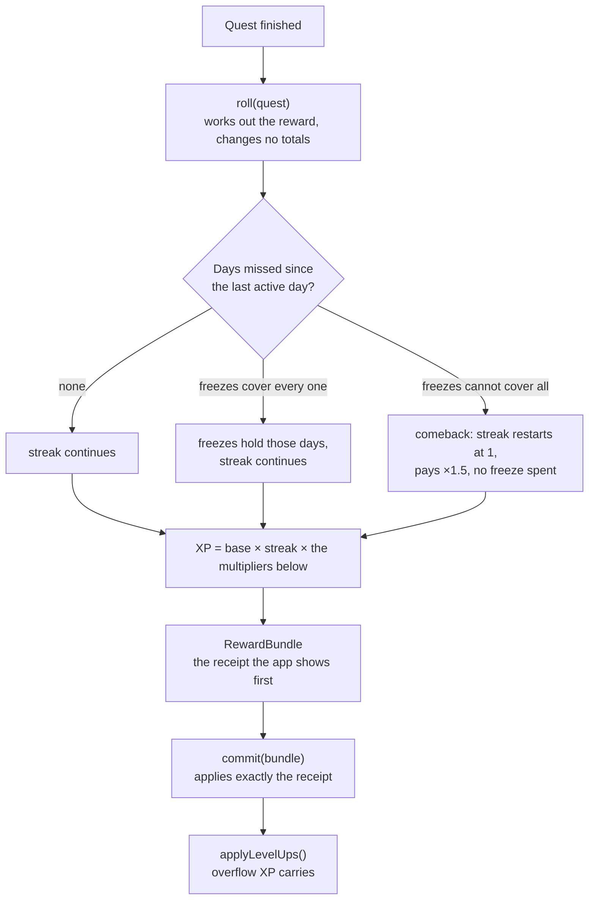

# Room of Days reward engine

The rules that decide what finishing a Quest is worth in [Room of Days](https://apps.apple.com/us/app/room-of-days/id6781401469), an iPhone habit app I came up with and took to the App Store in August 2026. Finishing a Quest earns XP, Glimmers and a life stat, a streak multiplies the XP, and streak freezes hold missed days.

This repo is that engine taken out of the app so it can be read and tested on its own: plain Dart, no Flutter, no network, no saved data. The full app repo is private.

The [case study](https://mikabe1805.github.io/projects/room-of-days.html) has a Quest board that runs these rules in the browser.

## Why six stats

Each Quest trains one of six life stats. They are there to get you doing different kinds of things and improving yourself from different angles, instead of always doing what's easiest.

| Stat | Quests like | What it changes in this engine |
| --- | --- | --- |
| Body | workouts, walks, sports, stretching | raises the chance of a critical hit |
| Care | meals, sleep, water, meds, plants, pets | at 40, freezes refill every 2 active days instead of 3 |
| Mind | reading, learning, reflecting | raises XP by up to 15% |
| Craft | deep work, projects, practice, skills | raises the chance of a loot drop in the app (loot is left out here) |
| People | reaching out, friends, family, plans | none in 1.0.4 |
| Home | chores, tidying, errands, repairs | makes the idle bonus up to 25% stronger |

The payouts lean the same way. The Quest you keep putting off pays ×1.35 and adds 3 to its stat, and a Quest you haven't done in a while pays up to 50% more. The same Quest done again on the same day pays less each time, and past 40 points of one stat in a day, that stat grows at half speed.

I always think about things from the user's side, so I also wanted a reason to raise all six stats instead of focusing on one. That became the weekly battle, a weekend fight where every stat is an ability, from Body's Power Slam to People calling in a friend. The Quests you finish for a stat during the week make its ability stronger, so working on your goals all week earns you an easier fight. The monster changes every week, one weak to Body and the next weak to Mind. The battle is in the internal TestFlight build of version 1.0.5 (build 56). It is not on the App Store yet, and its code is not in this repo.

## Run it

Needs the Dart SDK, 3.8 or newer (checked with 3.12.2).

```sh
dart pub get
dart test
dart run example/screenshot_day.dart
```

`dart test` runs 31 tests. The example plays the day shown in the App Store screenshots, then a missed day:

```text
Read ten pages               +26 XP · +8 Glimmers · +6 Mind · streak ×1.6
Clear the kitchen counter    +41 XP · +13 Glimmers · +11 Home · streak ×1.6
Message someone I miss       +26 XP · +8 Glimmers · +6 People · streak ×1.6

Monday, Aug 10. Sunday was missed.
Gap of 1 day, covered by freezes: true

Walk after lunch             +18 XP · +6 Glimmers · +3 Care · streak ×1.6 · 1 freeze held the gap
```

## How a completion is paid



| Part | Rule |
| --- | --- |
| Base | 10 × (0.5 + difficulty × 0.25), so difficulty 1 pays 7.5 and difficulty 10 pays 30 |
| Streak | ×1.0 rising to ×1.5 over the first 7 days, then to ×2.0 at day 30 |
| Dreaded Quest | ×1.35, and +3 to the stat |
| Timed completion | ×1.2 |
| Custom Quest | ×0.85, and ×0.5 on the day it was made |
| Comeback | ×1.5, at the restarted streak's multiplier |
| Idle bonus | +5% per day since the Quest was last done, up to +50%. Home makes it up to 25% stronger |
| Same Quest again today | 100%, then 50%, 25% and 10% |
| Mind | up to +15% |
| Daily cap | halved past 250 XP in a day, quartered past 400 |
| Critical hit | 3% chance, up to 10% with Body. ×1.5 to ×3 |
| Glimmers | a third of the XP, at least 1 |
| Stat gain | difficulty × 1.5, halved past 40 of that stat in a day |
| Freezes | 3 to start and room for 5. One more every 3 active days, every 2 at Care 40. Level 6 adds 2 and room for 7 |
| Levels | reaching level n takes 60 + (n - 1) × 45 XP |

## Decisions worth reading

- **A missed day never costs progress.** Stats never go down. A freeze is spent only when the freezes can cover every missed day, so the reserve is never used up on a streak that breaks anyway. Test: `an under-covered gap preserves every freeze and begins a warm return`.
- **A comeback pays at the new streak.** A bug hunt found that a return after a broken 30-day streak would pay the old ×2.0 on top of the ×1.5 welcome back. It pays at the day-one multiplier, and the XP shown on the card never promises more than the tap pays. Test: `a comeback pays at the new streak, not the broken one`.
- **Roll and commit are separate.** `roll` works out the receipt without changing any totals, so the app can show it and fill the XP bar before `commit` applies the same numbers. The freeze numbers travel inside the receipt, so a completion that itself lifts Care to 40 follows one rule in both steps. Test: `the completion that reaches CARE 40 uses the shorter cadence`.
- **Days are calendar days.** Gaps are counted in calendar dates, so a daylight-saving weekend with its 23-hour day can't invent or hide a missed day. Saved day keys are read strictly: 2026-02-31 is refused instead of becoming March 3. Tests: `test/calendar_test.dart`.
- **Milestone chests are paid once.** The 7, 30 and 100 day chests are paid inside the once-a-day streak step. An earlier version paid the 30-day chest on every Quest that day, so six Quests paid 1,200 Glimmers instead of 200. Test: `a milestone chest is paid once, however many Quests that day`.
- **Grinding pays less, never nothing.** Repeats and long days are damped by multipliers that never reach zero. Test: `the same Quest again today pays 100%, 50%, 25%, then 10%`.

## What's here

| File | What it is |
| --- | --- |
| `lib/src/reward_engine.dart` | The engine: `roll`, `commit`, `xpPreview`, `applyLevelUps`, `rollover` |
| `lib/src/reward_bundle.dart` | The receipt for one completion, and the result of a level-up |
| `lib/src/days.dart` | Day keys and calendar-day distance |
| `lib/src/clock.dart` | The one place the engine reads the time, so tests can set it |
| `lib/src/quest.dart`, `lib/src/stat.dart` | The parts of a Quest the engine reads, and the six stats |
| `test/` | 31 tests |
| `example/screenshot_day.dart` | The App Store screenshot day, played through the engine |

## Where it came from

The code is cut from `GameState` in the app's `lib/engine.dart` at version 1.0.4, build 49. The App Store has build 42 of the same version. The XP, streak and freeze code is the same in both; build 49 adds the line in a level-up that says how many Quests earned it. The formula, the streak and freeze rules and the comments on them are copied unchanged. The app's class does more: loot drops, reward messages, goals, achievements, the room and saving. Those parts are left out, and it is a plain class here instead of a Flutter `ChangeNotifier`.

Some names are older than the app's wording. In code the stats are `str`, `vit`, `intl`, `foc`, `soc` and `dis`, which the app shows as Body, Care, Mind, Craft, People and Home. Glimmers are `embers` in code. The comments cite design notes (RESEARCH.md, DESIGN.md, ROADMAP.md) that stay in the private repo.

The streak freeze, daylight-saving and level-up tests are ported from the app's test suite. The formula tests are new for this repo; the first two check the receipts in the App Store screenshots.

## How it was built

I came up with Room of Days and own its product direction and game design. The app was built with AI coding agents, Claude Code and Codex, working under my direction: I decided what to build, reviewed the results and tested the builds with family and outside testers before they shipped. This sample was carved out of the app the same way, by Claude Code.

Copyright 2026 Mika Be. Shared to be read; no license is granted for reuse.
